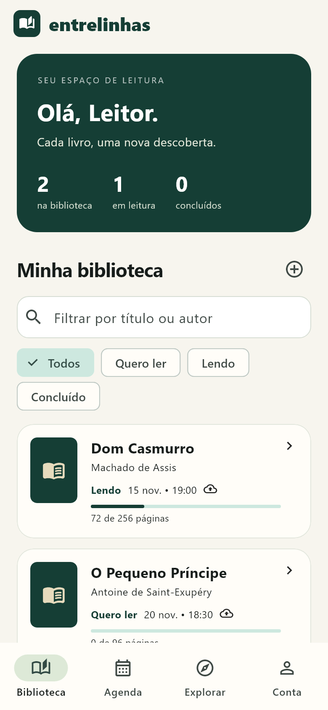
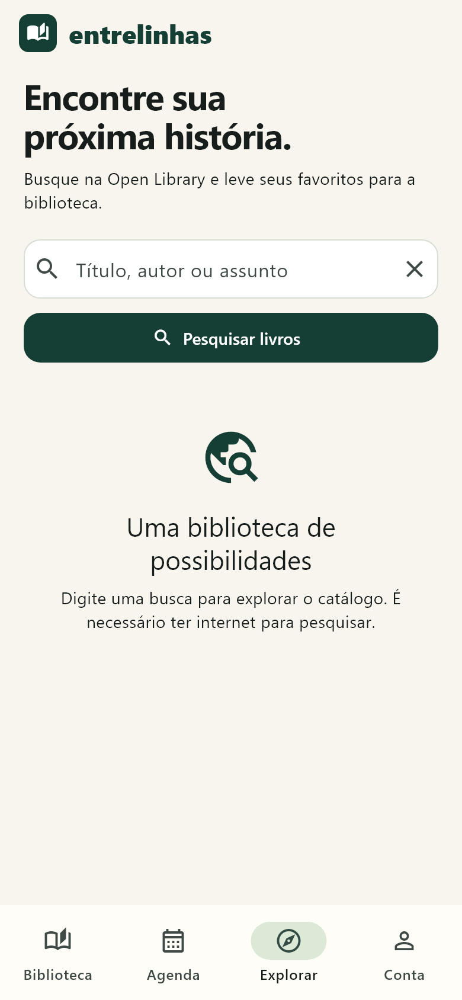

# Entrelinhas • Biblioteca

Biblioteca pessoal e agenda de leitura desenvolvida em Flutter/Dart, somente para **Android**. O aplicativo reúne livros, anotações, progresso de leitura, calendário e o local em que a leitura acontece.

**Tema:** BIBLIOTECA. **Integrante:** Eduardo Bizzi. **Disciplina:** Desenvolvimento de Aplicações Mobile — UNICENTRO.

## Situação desta versão

O FlutterFire configurou o app Android no projeto `biblioteca-2b8bf`, e as regras e os índices foram publicados no Firestore. As dependências estão registradas no `pubspec.lock` e a análise estática passou sem diagnósticos. A compilação de depuração gerou um APK e o app abriu no emulador. Para a entrega, faltam executar o roteiro completo no dispositivo e gerar o APK de release.

Em 23/11/2026, os 38 testes passaram com `flutter test --no-pub`, incluindo o login em telas de 320 pixels. Oito cenários adicionais da fila offline usam SQLite real e cinco verificam HTTP controlado. Veja os resultados e os testes no dispositivo previstos no [relatório de validação](docs/VALIDACAO.md).

## Funcionalidades no código

- Login, cadastro com nome e confirmação de senha, recuperação por e-mail e logout usando Firebase Authentication.
- Biblioteca com criação, listagem, busca local, detalhes, edição, exclusão, status e progresso de leitura.
- Gravação inicial no SQLite; envio para `users/{uid}/registros/{uuid}` no Firestore; remoção da alteração local somente após confirmação.
- Fila persistente de exclusões offline, IDs estáveis e proteção de edições realizadas durante um envio.
- Consulta de dados sincronizados pelo cache persistente do Firestore, mantendo o SQLite apenas para pendências, como exige o enunciado.
- Sincronização ao iniciar, ao retornar ao aplicativo, ao mudar a conectividade, a cada 30 segundos quando há pendências e por comando manual.
- Calendário mensal funcional com seleção, navegação, marcadores e cadastro na data escolhida, utilizando `table_calendar`.
- GPS, permissões, latitude/longitude e associação das coordenadas ao livro.
- Uma imagem por livro, escolhida da galeria ou câmera e copiada para armazenamento durável do aplicativo. Fotos são locais e não são enviadas ao Firestore.
- Busca real de livros na Open Library com `http`, JSON, paginação e tratamento de erros; o resultado pode preencher o cadastro.
- Ícone próprio, splash nativa Android e Flutter, tema padronizado e navegação adaptada à largura disponível.

## Base dos projetos da disciplina

| Projeto de referência em `C:\Flutter` | Conceitos aproveitados |
| --- | --- |
| `Trabalho-1-Desenvolvimento-Mobile` | Tema biblioteca, Open Library, `http.get`, JSON, busca e navegação para detalhes. |
| `apk_auth` | Inicialização Firebase, `StreamBuilder`, login/cadastro e sessão. |
| `agenda_contatos` | Model, helper SQLite, formulário, câmera/galeria e persistência de fotos. |
| `apk_invertexto` | Separação entre `service` e `view`, requisições e mensagens de erro. |
| `apk_teste` e identidade dos demais projetos | Configuração de assets, ícone e splash. |

O projeto utiliza `StatefulWidget`, `setState`, `Navigator`, `FutureBuilder`, `StreamBuilder`, `ListenableBuilder` e um `ChangeNotifier` próprio para compartilhar a biblioteca. Não acrescenta uma biblioteca externa de gerenciamento de estado.

## Tecnologias e dependências

Flutter 3.44.9 / Dart 3.12.2 foram identificados no ambiente da disciplina. O destino Android exige Android 7.0/API 24 ou superior, SDK Android compatível e Java compatível com o Gradle do Flutter instalado. Neste computador há um JDK em `C:\Android\jbr`.

| Pacote | Uso |
| --- | --- |
| `firebase_core` | Inicialização real do Firebase. |
| `firebase_auth` | Autenticação e recuperação de senha. |
| `cloud_firestore` | CRUD remoto e cache persistente. |
| `sqflite`, `sqflite_common`, `path` | SQLite Android e API de banco separada da interface. |
| `connectivity_plus` | Mudanças de rede; confirmação real continua dependendo do servidor. |
| `geolocator` | Permissão e GPS. |
| `table_calendar`, `intl`, `flutter_localizations` | Calendário e datas em português. |
| `image_picker`, `path_provider` | Câmera/galeria e arquivos duráveis. |
| `http` | Open Library. |
| `uuid` | ID do registro e ID de cada alteração. |
| `url_launcher` | Abrir as coordenadas no mapa externo. |
| `flutter_launcher_icons`, `flutter_native_splash` | Geradores de identidade Android. |
| `flutter_test`, `sqflite_common_ffi`, `sqlite3` | Testes e verificação local com SQLite verdadeiro. |

As versões declaradas estão em `pubspec.yaml`. O `pubspec.lock` foi gerado por uma resolução completa com `flutter pub get --offline`, reutilizando pacotes reais já instalados. Inclua o lock no repositório para reproduzir as versões.

## Configurar o Firebase uma vez

1. Abra o projeto [biblioteca no Firebase Console](https://console.firebase.google.com/project/biblioteca-2b8bf/overview), já criado para este aplicativo. Seu ID é `biblioteca-2b8bf` e está definido no `.firebaserc`. O app Android foi registrado como `br.edu.unicentro.biblioteca`. Baixe seu `google-services.json` para `android/app/google-services.json`. Não é necessário habilitar Analytics nem contratar serviços pagos para estas funcionalidades.
2. Em **Authentication → Sign-in method**, habilite **E-mail/senha**.
3. Em **Firestore Database**, crie o banco padrão no modo de produção e escolha a região. O aplicativo não depende de Firebase Storage: a foto é local.
4. No terminal, confira `flutter --version`. Se o Firebase CLI/FlutterFire CLI ainda não estiverem instalados, use `npm install -g firebase-tools` e `dart pub global activate flutterfire_cli`. Depois execute `firebase login`.
5. Na raiz do projeto, execute:

```powershell
.\scripts\configurar_firebase.ps1
```

O script utiliza **FlutterFire CLI**, configura somente Android no projeto `biblioteca-2b8bf` e gera `lib/firebase_options.dart` e os arquivos necessários para o pacote `br.edu.unicentro.biblioteca`, já registrado no Console. Ele também gera ícone e splash a partir dos assets incluídos. Para outro projeto, informe `-ProjectId "ID_REAL"`.

6. Publique as regras de isolamento e validação incluídas neste projeto:

```powershell
firebase deploy --only firestore --project "biblioteca-2b8bf"
```

Não habilite regras públicas para contornar erros. Cada usuário só pode acessar seu próprio caminho `users/{uid}/registros`. Nenhuma senha, token de acesso, chave privada ou conta de serviço deve ser colocada no repositório. A configuração pública gerada pelo FlutterFire não substitui as regras de segurança.

## Rodar no emulador Android

Depois da configuração acima, abra seu emulador pelo Android Studio e, na raiz deste projeto, execute:

```powershell
flutter pub get
flutter devices
flutter run -d "ID_DO_EMULADOR"
```

Copie o ID real mostrado por `flutter devices`. Caso só haja um dispositivo disponível, `flutter run` é suficiente.

No Windows, se o Flutter pedir suporte a links simbólicos, habilite o Modo de Desenvolvedor do Windows conforme a orientação exibida pelo próprio Flutter. Se o Gradle encontrar o Java 8, configure o JDK do Android Studio, por exemplo `flutter config --jdk-dir="C:\Android\jbr"`, desde que esse caminho exista no seu computador.

Para o GPS, abra **Extended controls → Location** no emulador, selecione um ponto e envie a posição. No aplicativo, toque em **Obter localização atual** e aceite a permissão. O emulador pode fornecer uma foto de teste pela galeria ou pela câmera virtual.

O primeiro login e a criação de conta exigem internet. Depois de autenticado, a sessão é persistida e pode ser reaberta offline. Desligar somente o Wi-Fi pode deixar os dados móveis ativos no emulador: confira o indicador de conexão ao demonstrar o modo offline.

## Conferir e gerar o APK

```powershell
.\scripts\verificar_e_compilar.ps1
```

O script para na primeira falha: confere dependências, formatação, `flutter analyze`, `flutter test`, configuração real e `flutter build apk --release`. Para executar apenas as verificações locais, inclusive antes de configurar o Firebase, use `-SomenteVerificar`.

Depois de habilitar E-mail/senha e criar o Firestore no Console, também é possível configurar o FlutterFire, publicar as regras e executar a verificação/compilação em uma sequência:

```powershell
.\scripts\finalizar_android.ps1
```

Execute essa sequência em um terminal normal com internet e acesso ao SDK Android. Ela não substitui a demonstração prática no dispositivo.

Após obter as dependências, as verificações locais que dispensam a engine Flutter também podem ser repetidas com `dart run scripts/verificar_offline.dart` e `dart run scripts/verificar_api.dart`. Elas não substituem os testes Android/Firebase.

APK esperado após uma compilação bem-sucedida: `build/app/outputs/flutter-apk/app-release.apk`. A assinatura de desenvolvimento do template permite instalação e apresentação acadêmica. Um APK ainda não foi gerado nesta sessão.

```powershell
flutter install -d "ID_DO_EMULADOR" --use-application-binary=build/app/outputs/flutter-apk/app-release.apk
```

## Estrutura

| Local | Responsabilidade |
| --- | --- |
| `lib/main.dart` | Inicialização, idioma, splash Flutter e controle da sessão. |
| `lib/database/model/` | Dados do livro/atividade e conversão para SQLite. |
| `lib/database/helper/` | Tabela SQLite, CRUD, tombstones e confirmação/limpeza. |
| `lib/service/` | Firebase Auth, Firestore, rede, sincronização, API, GPS e fotos. |
| `lib/controller/` | Combinação da nuvem com pendências e atualização da interface. |
| `lib/view/` | Login, biblioteca, busca, calendário, formulário, detalhes e conta. |
| `lib/widgets/`, `lib/theme/`, `assets/brand/` | Componentes e identidade visual. |
| `test/` | Casos automatizados de sincronização, API, modelo e formulário. |
| `scripts/` | Configuração, compilação e verificação SQLite sem engine. |
| `docs/` | Matriz de requisitos, roteiro de testes, defesa e validação. |

## Imagens das telas

As imagens abaixo são renderizações automatizadas dos widgets reais de login, biblioteca e busca, em tamanho de telefone. A biblioteca usa dados de demonstração; estas prévias não representam uma sessão autenticada no Firebase nem uma execução no Android. As capturas finais de formulário, calendário e integrações devem ser acrescentadas depois da validação no emulador.

| Login | Biblioteca | Explorar |
| --- | --- | --- |
|  |  |  |

[Ícone personalizado do aplicativo](assets/brand/icon.png).

## Documentação para entrega e defesa

- [Requisitos do PDF, evidências e pendências](docs/REQUISITOS.md)
- [Roteiro completo de testes e apresentação prática](docs/ROTEIRO_DE_TESTES.md)
- [Explicação do código e roteiro para defesa individual](docs/DEFESA.md)
- [Verificações efetivamente realizadas](docs/VALIDACAO.md)

O repositório Git local foi inicializado. Para disponibilizá-lo ao professor, crie um repositório remoto, cadastre o endereço real em `git remote add origin URL_DO_REPOSITORIO` e envie os commits com `git push -u origin main`. Confira `git status` e não inclua `.tooling`, senhas ou tokens. Conceda acesso ao professor se o repositório for privado.

Para gerar uma cópia do fonte atual, execute `python scripts/empacotar_fonte.py`. O ZIP inclui os testes e as alterações ainda não commitadas, usando a lista de arquivos permitidos pelo Git. Caches, configurações privadas de ferramentas, builds e plataformas extras ficam fora. Essa cópia não substitui o histórico de commits nem o repositório remoto exigido pelo trabalho.

## Referências técnicas

- [Adicionar Firebase ao Flutter](https://firebase.google.com/docs/flutter/setup)
- [Autenticação por e-mail e senha](https://firebase.google.com/docs/auth/flutter/password-auth)
- [Cache offline do Firestore](https://firebase.google.com/docs/firestore/manage-data/enable-offline)
- [Regras de segurança](https://firebase.google.com/docs/firestore/security/get-started)
- [SQLite no Flutter](https://docs.flutter.dev/cookbook/persistence/sqlite)
- [Connectivity Plus](https://pub.dev/packages/connectivity_plus)
- [Geolocator](https://pub.dev/packages/geolocator)
- [Table Calendar](https://pub.dev/packages/table_calendar)
- [Image Picker](https://pub.dev/packages/image_picker)
- [Open Library Search API](https://openlibrary.org/dev/docs/api/search)
- [Botões Material no Flutter](https://docs.flutter.dev/release/breaking-changes/buttons)
